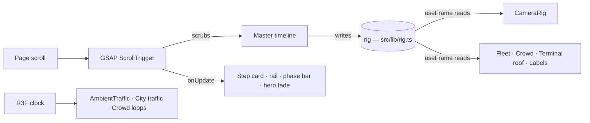

# Architecture

## Data flow

- **One timeline.** Its total duration equals `KEY_COUNT - 1`, so timeline time `t = n` is camera key `n`. Each key holds for 40 % of its segment, then glides to the next.
- **No React state while scrolling.** The only React update is the active-step index, which changes 12 times over the whole scroll.
- **Two clocks.** Story motion follows the scroll. Ambient life (circuits, overflights, cars, crowd loops, carousels, radar) follows wall-clock time, so the airport never looks frozen.

## Camera keys

| Key | Shot | Story channels animated around it |
|---|---|---|
| 0 | Hero overview | — |
| 1 | AP-22 Ground transportation | `arriveT` (taxi pulls in), `arrivePax` |
| 2 | AP-17 Check-in & security | `roof` lifts |
| 3 | AP-18 Duty-free | — |
| 4 | AP-20 Lounge | `roof` closes after |
| 5 | AP-07 Jet bridge | `paxGate` |
| 6 | AP-08 Apron bus | `busT`, `paxApron` |
| 7 | AP-09 VIP | `vipT` |
| 8 | AP-03 Pushback & taxi | `planeT` 0 → 0.3 |
| 9 | AP-12 Takeoff (follow-cam on aircraft A) | `planeT` 0.3 → 0.66 |
| 10 | AP-13 Cruise (follow-cam on aircraft A) | `planeT` 0.66 → 1 |
| 11 | AP-16 Landing (follow-cam on aircraft C) | `landT` |
| 12 | AP-19 Baggage claim | `roof` lifts again |
| 13 | Outro overview | — |

Follow-cams blend between a static shot and an offset from a moving aircraft using the `followA` / `followC` weights. Both weights are tweened by the same timeline.

## World layout (metres, ground plane XZ, +Y up)

| Feature | Location |
|---|---|
| Runway 09L/27R | z = 63, x ±190, 20 m wide |
| Runway 09R/27L (ambient circuits) | z = 105 |
| Taxiway 1 / Taxiway 3 | z = 42 / z = 125 |
| Apron | z −14 … 34 |
| Terminal | x −100 … 30, z −32 … −14 |
| Curb road (4 lanes) | z −56 … −40 |
| Ring road | z −80 … −70 |
| Commercial district | x −200 … 12, z −205 … −80 |
| Residential area | x 34 … 200, z −205 … −80 |
| Cargo apron | x −75 … 75, z 131 … 152 |

## Models

`scripts/build-models.mjs` builds every model from Three.js primitives and exports it with `GLTFExporter`. A tiny `FileReader` polyfill lets the exporter run in Node. Run `npm run build:models` after editing the script. Materials carry stable names (`Body`, `Livery`, `Tail`, `Shell`, …) so you can identify them in Blender or recolour them in code.
